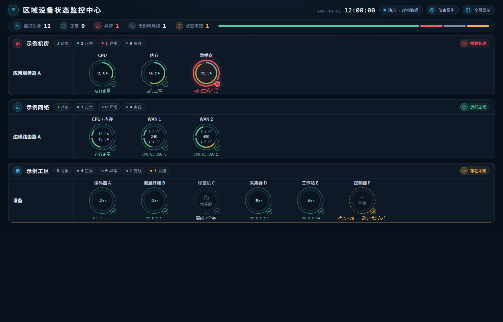

# 区域设备状态监控中心

圆形仪表大屏，以及监控项目、区域管理、系统设置三个后台页面。一个 Next.js 应用同时提供页面和服务端 API，SQLite 保存唯一共享配置，服务端读取 Zabbix 7.0 的真实数据。正式入口从服务端读取配置和采样。

## 演示



安装 Node.js 24 和本项目指定的 pnpm 后运行：

```sh
pnpm install --frozen-lockfile
pnpm dev
```

打开 [本地演示页面](http://localhost:3000/demo)。示例读数每 5 秒更新，可全屏查看或打开仪表图例。区域、设备、地址与数值均为虚构，地址使用文档示例网段。此入口无需配置数据库或监控服务。正式入口是 `/`，需要单独配置真实数据源。

## 当前运行环境

- Ubuntu 桌面系统，Node.js 24，pnpm 12.3.4，Next.js 16.4.3。
- 单实例 systemd 服务，非 root 应用用户 `regional-monitor`，监听 `0.0.0.0:80`。
- 程序：`/opt/regional-device-monitor/current`，指向 `releases/` 中的一个版本。
- 数据库：`/var/lib/regional-device-monitor/monitor.db`，不在程序目录中。
- 服务：`regional-device-monitor.service`；桌面浏览器由 kiosk 用户的 `chrome-kiosk.service` 启动。

首次启动没有区域和项目。初始管理员需由操作员创建，应用没有内置默认密码。部署机器的实际地址、已验证绑定和初始登录信息由部署交付文件单独提供，不写入仓库。

## 安装和检查

在源码目录中使用锁定的包管理器：

```sh
pnpm --version # 必须是 12.3.4
pnpm install --frozen-lockfile --package-import-method=copy
pnpm test
pnpm typecheck
pnpm build
```

测试使用临时 SQLite 数据库和隔离的 JSON-RPC HTTP 测试服务；生产代码不会调用这些测试数据。独立类型检查和生产构建均是发布检查的一部分。

运行环境变量：

| 变量 | 用途 |
| --- | --- |
| `NODE_ENV=production` | 生产运行 |
| `MONITOR_DB_PATH` | 持久数据库绝对路径 |
| `MONITOR_ALLOWED_ORIGINS` | 逗号分隔的允许写入来源，例如笔记本 IP 的 HTTP 来源及需要的回环来源 |
| `NEXT_TELEMETRY_DISABLED=1` | 关闭构建和运行遥测 |

生产服务必须显式设置允许来源。修改访问地址时同步更新该变量，并重新加载 systemd 配置。Zabbix 地址和 Token 通过系统设置保存到数据库；Token 只写不读，读取配置仅返回是否已配置。

首次创建管理员时，在应用用户身份和相同的 `MONITOR_DB_PATH` 下执行 `node scripts/bootstrap.mjs`，通过标准输入传入至少 12 位密码。重复初始化会被拒绝。不要把密码放入命令行参数、仓库或公开日志。

## 使用

- `/`：无需登录的大屏。
- `/admin/projects`：添加、编辑、删除、隐藏、区域和排序、状态值映射、数值监控项和项目独立故障绑定。
- `/admin/regions`：区域添加、改名、排序和删除空区域。
- `/admin/settings`：真实 Zabbix 连接测试、布局、仪表大小、配色、刷新间隔和管理员密码。

只有一个管理员，登录仅输入密码。修改密码需提供当前密码，新密码至少 12 位；修改后所有管理会话失效，需要重新登录。大屏查看不受影响。

后台从真实 Zabbix 查询主机、监控项和触发器。可按名称、键值或准确 ID 查找。主机启用不代表在线，状态由所选监控项和明确的值映射决定。一个主机可以对应多个项目。对于只上报成功的 `agent.ping`，离线映射可以留空；采集失联会显示未知。

接口链路状态不等于外网连通性。WAN 速率可直接显示 bps；计算带宽百分比必须提供与原始速率同单位的真实线路容量。功率仪表必须配置实际量程。100% 数值本身不会产生故障，故障只来自明确绑定的触发器。

共享配置在 SQLite 中事务保存，并有版本冲突检查。冲突时先保留草稿，再由管理员明确重新载入。浏览器默认每 5 秒读取快照，成功响应后扣除本次请求耗时再安排下一次，避免请求重叠；页面恢复可见时刷新。Zabbix 读取由服务端共享约 10 秒缓存，布局变化直接体现在新快照中。浏览器刷新周期不改变 Zabbix 的采样周期。

绿色表示有可靠正常证据，红色表示明确故障或必须在线的项目已确认离线，灰色表示允许离线的项目已确认离线，黄色表示未知。状态与数值的有效性独立判断。数据源失败、过期或不支持不会回退到演示值；离线时不显示旧数值。离线起点需要历史连续性证据，证据不足时显示时长未知。

流量仪表在一张圆图里显示上传速率、连接数和下载速率。项目编辑中从同一 Zabbix 主机分别绑定上传、下载与可选的连接数监控项；选择连接数时注明主机或端口范围。WAN 项目没有端口级连接数采样时保持不绑定，仪表显示 `—`。仪表量程可按 Mbps 分别填写，留空时不显示相应弧线。超过量程时弧线画满，仍显示实际速率；量程不限制网速。

所有速率展示统一换算为 Mbps，源采样和历史接口仍保留规范的 bps 数值。圆内省略单位，数值按 `0.00`、`12.3`、`123`、`9999` 显示；四舍五入后按位数缩减小数，不补整数前导零。超过四位整数显示「超限」，完整数值可在悬浮说明与历史中查看，不截成虚假的 9999。圆内文字统一使用 12px 新宋体（NSimSun），不显示 CPU、内存或其他指标标签；上半环 CPU、下半环内存的意义保留在悬浮说明和历史中。展示电脑需安装 NSimSun；字体文件不随仓库发布。

正常的流量链路下方显示该接口的 IPv4 地址。服务端在共享快照读取中查询同主机现有 `ikuai.full.json[ip_20]` 完整地址表，通过所绑定状态项的 ifIndex 对应 IP-MIB 地址及接口编号；遵循该表的真实采样周期和心跳，缺失或过期显示「IP 未获取」。没有 IP 的物理口不借用其拨号接口或管理口地址。离线、未知或故障时仍优先显示对应状态说明。

选择「CPU / 内存」可在一张圆图里显示两种使用率：上半圈 CPU，下半圈内存。从同一主机分别绑定两个实际使用率的数值监控项，来源单位须为 `%`，且不能复用状态项。缺少有效采样的一项显示 `—`；另一项及设备状态仍按自身证据显示。iKuai 的内存使用率沿用已用内存监控项的口径，包含缓存和缓冲区。

点击或用键盘打开 Zabbix 项目可查看最近 1 小时、24 小时或 7 天的 Zabbix 历史。流量图共用时间轴，左轴显示速率、右轴显示连接数。CPU 和内存两条曲线共用 0–100% 的百分比轴。图例可切换曲线，时间游标可用方向键查看各通道的同一时段。曲线按时段显示采样均值，统计基于返回的原始有效采样。缺失时段保留空白，当前状态未知时仍可查询历史；连通性条带仅展示状态采样证据。

API、字段、时间单位和错误分类见 [docs/API.md](docs/API.md)。

## 爱快 API 实时接入

已验证的 iKuai 4.0.317 本机 API 可为明确绑定的路由器与逻辑 WAN 项目提供实时数据；其他设备继续使用 Zabbix。服务端通过 HTTPS 验证证书链和配置中的证书 DNS 名称，GET 请求带 Bearer Token，不跟随重定向。为每台路由器分别配置管理地址、证书 DNS 名称和项目绑定。

私密连接和项目绑定保存在同一 SQLite 的 `ikuai_connection` 表中，包含在正常数据库备份里。配置读取只返回 Token 是否存在。由服务器管理员将 `version` 与 `connection` JSON 经标准输入传给 `scripts/configure-ikuai.mjs`；connection 包含 `url`、`token`、`tlsServerName`、`hostId`、`bindings`，每个绑定包含 `projectId`、`statusItemId`、`kind`，流量绑定另有明确的 `interface`。更换主机、状态项或仪表类型后原绑定不再匹配，需重新配置。不要将真实 Token 放入命令行参数或源码。

系统与接口实时接口分别每 5 秒最多请求一次，跨仪表和浏览器合并在途请求，2.5 秒总超时，失败不会回退到旧 Zabbix 绿色状态。浏览器按共享刷新设置运行，当前设为 5 秒并扣除本次请求耗时；超时不堆积请求。实时 API 未返回采样时间，仪表时间标识为服务端收到数据的时间。CPU 取总使用率 `cpu[0]`，内存取 `memory.used`；WAN 速率由字节/秒乘 8 转为 bps，再显示 Mbps。连接数只读取对应逻辑 WAN 的 `connect_num`，`--` 或字段缺失显示空值。未知线路检测结果显示未知，不能据此推断离线起点。

CPU、内存历史直接读取爱快 API 的分钟采样，按原有 1 小时、24 小时、7 天视图聚合，缺少时段留空，不补历史在线状态。WAN 的实时数据来自 API，历史暂时继续使用明确标注的 Zabbix 数据：本机 WAN 历史 API 目前仅返回约最近一小时，原始速率单位尚未充分确认，因此不将其混入图表；每 WAN 历史连接数未找到。历史来源和限制在弹窗中说明。

## 服务与日志

```sh
sudo systemctl status regional-device-monitor
sudo journalctl -u regional-device-monitor -n 100 --no-pager
sudo journalctl -u regional-device-monitor -f
sudo systemctl restart regional-device-monitor
sudo systemctl is-enabled regional-device-monitor
curl -fsS http://127.0.0.1/api/health
```

`/api/health` 只检查应用和数据库可用性，不等待 Zabbix。浏览器启动脚本先等待该接口，再打开笔记本 IP。浏览器使用 `--start-fullscreen`，可用 F11 退出全屏，页面右上角可进入后台。

## SQLite 在线备份

下面的命令可在服务运行时执行。SQLite backup API 会包含已提交的 WAL 数据；不要直接复制运行中的 `monitor.db` 文件充当备份。

```sh
sudo install -d -o regional-monitor -g regional-monitor -m 700 /var/lib/regional-device-monitor/backups
backup_file="/var/lib/regional-device-monitor/backups/monitor-$(date +%Y%m%d-%H%M%S).db"
sudo -u regional-monitor env MONITOR_DB_PATH=/var/lib/regional-device-monitor/monitor.db \
  /opt/node-current/bin/node /opt/regional-device-monitor/current/scripts/backup.mjs "$backup_file"
```

目标文件必须尚不存在。备份包含 Zabbix Token 和管理员密码哈希，保持 600 权限，并将备份另存到受控的其他存储设备。

## 恢复

先确认使用的是上述方法产生的独立备份，并检查完整性：

```sh
sudo python3 - "$backup_file" <<'PY'
import sqlite3,sys,pathlib
uri=pathlib.Path(sys.argv[1]).resolve().as_uri()+'?immutable=1'
with sqlite3.connect(uri,uri=True) as db:
    result=db.execute('PRAGMA integrity_check').fetchone()[0]
    assert result=='ok',result
    print('SQLite backup integrity: ok')
PY
```

然后停服务，将旧库及其 WAL/SHM 一起移到回退目录，再安装备份：

```sh
sudo systemctl stop regional-device-monitor
db_file=/var/lib/regional-device-monitor/monitor.db
rollback_dir="/var/lib/regional-device-monitor/restore-before-$(date +%Y%m%d-%H%M%S)"
sudo install -d -o regional-monitor -g regional-monitor -m 700 "$rollback_dir"
for suffix in '' '-wal' '-shm'; do
  if sudo test -e "${db_file}${suffix}"; then
    sudo mv -- "${db_file}${suffix}" "$rollback_dir/monitor.db${suffix}"
  fi
done
sudo install -o regional-monitor -g regional-monitor -m 600 "$backup_file" "$db_file"
sudo systemctl start regional-device-monitor
curl -fsS http://127.0.0.1/api/health
```

不要将旧 WAL 留在恢复后的库旁边。恢复会还原备份时的配置、管理员密码和会话；在后台核对配置并按需修改密码。

## 更新程序

1. 先在线备份数据库。更新来源应是已审查的源码版本；可在源码仓库用 `git archive --format=tar.gz HEAD -o monitor-source.tar.gz` 生成不含依赖和私密配置的平铺源码包。
2. 将源码解压到新的 `/opt/regional-device-monitor/releases/<版本>` 目录。以 `regional-monitor` 用户安装锁定依赖并执行测试、类型检查和生产构建。父目录需可遍历，构建目录需由该用户写入。
3. 依赖安装使用 `--package-import-method=copy`，避免修改版本目录的文件所有者时连带改变共享 pnpm 缓存的硬链接。构建完成后将程序目录交由 root 管理、保留应用用户读取和执行权限。不要将数据库复制进版本目录，不要在更新过程中重新初始化管理员。
4. 将 `current` 链接切换到新版本，执行 `sudo systemctl restart regional-device-monitor`，检查健康接口、日志、大屏及后台。保留上一个程序版本和更新前的数据库备份。

更新代码、重建和服务重启都不会清空数据库。如果需要回退程序，先确认数据库迁移兼容性；不兼容时停服务并一并恢复更新前的数据库备份。不要通过 `git pull` 覆盖持久目录，也不要用开发服务器代替 systemd 生产服务。


仪表显示：CPU、内存固定一位小数并在等宽区域右对齐，含方向箭头、状态文字与 WAN IP 使用新宋体。圆圈基础直径 84px（超大屏 108px），保留后台大小缩放。上下半环分别按各自量程计算，负载沿内环从绿色渐变到橙色；不改变外环设备状态或产生故障告警。
